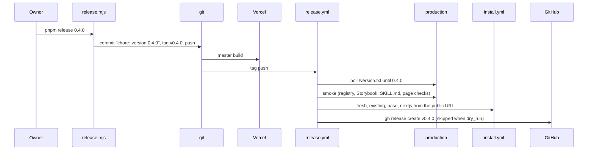

# 01: release automation

## 1. Architecture

### 1.1 Overview

Releases today are a six-step manual checklist (`.ai/plans/v0.2-base-ui/anindosarker/
04-release.md`). Decision: [decisions.md](decisions.md) "Release". A release is one command;
a workflow does the verification and the GitHub release, or fails without releasing.

### 1.2 Goals

- `pnpm release 0.4.0` on a clean `master` bumps both versions, commits, tags `v0.4.0`,
  pushes commit and tag; nothing else is typed
- The tag push runs `release.yml`; on success a GitHub release `v0.4.0` exists with the
  `## 0.4.0` section of `CHANGELOG.md` as notes, marked latest
- Any failed check: no release, red run, failing step named
- `release.yml` on `workflow_dispatch` with `dry_run` runs every check and skips the
  release; that run at the first milestone proves the workflow, so no intermediate tag is
  needed and the only tag of the cycle is `v0.4.0`
- The script refuses a dirty tree, a branch other than `master`, a version not greater than
  the current one, or a missing changelog section, before touching anything

### 1.3 Current structure

```
.github/workflows/
└── ci.yml                       ← push on master and claude/review; install matrix inline
packages/shadcn-table/package.json   ← "version"
apps/shadcn-table-docs/package.json  ← "version", mirrors the library
```

### 1.4 Target structure

```
.github/workflows/
├── ci.yml                       ← calls install.yml with a GitHub address and ref
├── install.yml                  ← reusable: the install matrix, input `source`
└── release.yml                  ← on tag v*, or workflow_dispatch with dry_run
scripts/
├── release.mjs                  ← pnpm release <version>
└── release/
    ├── smoke.mjs                ← production checks with fetch
    └── notes.mjs                ← extracts the version section of CHANGELOG.md
apps/shadcn-table-docs/app/version.txt/route.ts   ← static, library version as text
CHANGELOG.md                     ← Keep a Changelog, newest first
```

### 1.5 Flow



### 1.6 Components

#### 1.6.1 Data artifacts

`CHANGELOG.md` at the repo root, Keep a Changelog format, newest first. `## Unreleased` on
top during work; `scripts/release.mjs` renames it to `## <version>` with the date as part of
the bump. Seeded with the v0.3.0 notes from PR #19 and the v0.1.x entries from the existing
GitHub releases.

#### 1.6.2 scripts/release.mjs

The one command. Root `package.json` script `"release": "node scripts/release.mjs"`.

- Guards, in order: `git status --porcelain` empty; branch `master`; after `git fetch`,
  local equals `origin/master`; argument is semver and greater than the library version;
  `CHANGELOG.md` has `## Unreleased` or `## <version>`
- Writes `version` into `packages/shadcn-table/package.json` and the docs app
  `package.json`; renames the changelog heading
- `git commit -m "chore: version <v>"` with only those files; `git tag v<v>`;
  `git push origin master v<v>`
- Does NOT publish to npm, does NOT run the checks (the workflow does)

**Operations:**

| Operation            | Status | Notes                                 |
| -------------------- | ------ | ------------------------------------- |
| `pnpm release <v>`   | new    | exits non-zero before any write on a failed guard |

#### 1.6.3 version.txt route

`app/version.txt/route.ts` in the docs app, `revalidate = false`, returns the library
version read from `packages/shadcn-table/package.json` at build time, `text/plain`, one
line. The workflow polls it to know production serves the tagged commit; Vercel builds
`master` on the version commit, so tagged and deployed commits are the same.

**Operations:**

| Operation           | Status | Notes          |
| ------------------- | ------ | -------------- |
| `GET /version.txt`  | new    | static         |

#### 1.6.4 release.yml

Triggers: `push` on tags `v*`; `workflow_dispatch` with boolean input `dry_run` (default
true) and string input `version` (the version to verify). Jobs, each `needs` the previous.

| Job                 | Status | Notes                                                                                       |
| ------------------- | ------ | ------------------------------------------------------------------------------------------- |
| wait-for-production | new    | poll `https://www.shadcn-table.com/version.txt` every 30 s until it equals the version, 20 min timeout |
| smoke               | new    | `scripts/release/smoke.mjs` then `check-pages.mjs` against the production URL               |
| install             | new    | `install.yml` with `source` = `https://www.shadcn-table.com/r/<base>/shadcn-table.json`      |
| release             | new    | `scripts/release/notes.mjs <v>` then `gh release create v<v> --title v<v> --notes-file`; `--latest`, or `--prerelease` when the version contains `-`; skipped when `dry_run` |

`smoke.mjs` (Node `fetch`, no curl): `/r/radix/shadcn-table.json` and
`/r/base/shadcn-table.json` return 200 and their `dependencies` contain the
`@tanstack/react-table` pin from `packages/shadcn-table/package.json`; `/r/radix/registry.json`
and `/r/base/registry.json` list the same item names as the committed catalog;
`https://storybook.shadcn-table.com/` and `/base/` return 200 HTML; `/SKILL.md` returns 200
and contains both base labels; `/llms.txt` returns 200. `check-pages.mjs` takes a base URL
(confirm; add the flag if not).

#### 1.6.5 install.yml

The existing `install` matrix from `ci.yml` (`fresh`, `existing`, `base`, `nextjs`) as a
reusable workflow with input `source`: a GitHub address with ref (CI) or a public URL prefix
(release). `ci.yml` calls it, so the two cannot drift.

**Operations:**

| Operation             | Status   | Notes                              |
| --------------------- | -------- | ---------------------------------- |
| install matrix        | refactor | moved out of `ci.yml`, parameterised |
| `ci.yml` install job  | refactor | `uses: ./.github/workflows/install.yml` |

**Stays unchanged:** every other `ci.yml` job; the scenarios' steps and assertions.

### 1.7 Dependencies and env

- No new packages. `gh` is preinstalled on GitHub runners; `GH_TOKEN` is `github.token`.
- No new env vars.

## 2. Instructions for AI

### 2.1 Phases

#### 2.1.1 Phase 1: Script and route

- `scripts/release.mjs` per 1.6.2; `CHANGELOG.md` seeded per 1.6.1
- `app/version.txt/route.ts` per 1.6.3

#### 2.1.2 Phase 2: Workflows

- Extract `install.yml` per 1.6.5; `ci.yml` calls it; CI green
- `release.yml` per 1.6.4 with `smoke.mjs` and `notes.mjs`

#### 2.1.3 Final phase: Cleanup

- Mark `.ai/plans/v0.2-base-ui/anindosarker/04-release.md` as superseded by this part in
  its first line
- `pnpm format`; repo gates

### 2.2 Gates

- In a scratch clone: `node scripts/release.mjs 0.0.0` on a dirty tree, on a non-master
  branch and with a lower version each exit non-zero with the reason and write nothing
- `ci.yml` green with the install job on `install.yml`
- `release.yml` `workflow_dispatch` with `dry_run` against the current production version:
  wait, smoke and install green, release step skipped
