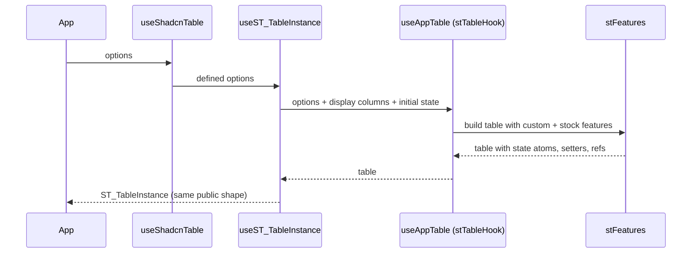

# 06: v9 architecture

## 1. Architecture

### 1.1 Overview

Our TanStack Table v9 port kept the v8-shaped hooks and registered only built-in features;
material-react-table's v9 port, now living in the TanStack repo, moved its own state into v9
custom features behind one `createTableHook`. Decision: [decisions.md](decisions.md)
"TanStack Table v9 architecture": same shape for us, public API unchanged, ships as `0.4.0`.
Runs after [04](04-package-layout.md) and [05](05-docs-app-layout.md); phase 00 may start
once 04 is merged.

### 1.2 Goals

- `features/` holds the library's own state and APIs as v9 custom features; one
  `createTableHook` in `hooks/stTableHook.ts`; `useST_TableInstance` wraps `useAppTable`;
  `utils/tanstack.features.ts` gone
- Public surface unchanged: `useShadcnTable`, `ShadcnTable`, `ST_TableOptions`, every `ST_*`
  option, prop and type name, the locale items
- Every file with an MRT twin matches the twin's shape or has a one-line tracker entry
  saying why not
- Both trees green on every gate; stories 400/400 on both bases; registry builds; CI install
  matrix passes

### 1.3 Current structure

Ours (per tree, `registry/<base>/components/ui/shadcn-table/`, 129 files):

```
shadcn-table/
├── body/ buttons/ fns/ footer/ head/ inputs/ locales/ menus/ modals/ table/ toolbar/
├── hooks/
│   ├── display-columns/
│   ├── useShadcnTable.ts  useST_TableInstance.ts  useST_TableOptions.ts  useST_Effects.ts
│   └── useST_Rows.ts  useST_ColumnVirtualizer.ts  useST_RowVirtualizer.ts
├── utils/
│   ├── tanstack.features.ts              ← tableFeatures of built-ins only
│   └── tanstack.helpers.ts  cell/column/displayColumn/row/style/pagination/virtualization .utils.ts  utils.ts
├── fns/sortFns.ts  aggregationFns.ts  filterFns.ts
└── icons.ts  index.ts  ShadcnTable.tsx  ST_Tooltip.tsx  types.ts
```

MRT v9 port (`../tanstack-table/examples/react/material-react-table/src/material-react-table/`,
139 files, head `95c476849`):

```
material-react-table/
├── components/  body/ buttons/ footer/ head/ inputs/ menus/ modals/ table/ toolbar/
├── features/
│   ├── mrtFeatures.ts                    ← tableFeatures({ ...stockFeatures, ...custom, row models, fn registries })
│   ├── mrtCellActionsFeature.ts  mrtColumnDraggingFeature.ts  mrtConfigFeature.ts  mrtDensityFeature.ts
│   ├── mrtEditingFeature.ts  mrtFilterModesFeature.ts  mrtFullScreenFeature.ts  mrtLoadingFeature.ts
│   └── mrtRefsFeature.ts  mrtRowDraggingFeature.ts  mrtToolbarsFeature.ts
├── hooks/
│   ├── mrtTableHook.ts                   ← createTableHook: useAppTable, useTableContext, useCellContext, useHeaderContext
│   ├── display-columns/  useMaterialReactTable.ts  useMRT_TableInstance.ts  useMRT_TableOptions.ts
│   └── useMRT_Effects.ts  useMRT_Rows.ts  useMRT_ColumnVirtualizer.ts  useMRT_RowVirtualizer.ts
├── fns/sortingFns.ts  aggregationFns.ts  filterFns.ts
├── locales/  utils/
└── icons.ts  index.ts  types.ts
```

File map: 123 twins. Ours only: `fns/sortFns.ts` (MRT `fns/sortingFns.ts`), `ST_Tooltip.tsx`,
`table/ST_TableLayout.tsx`, `toolbar/useST_MediaQuery.ts`, `utils/pagination.utils.ts`,
`utils/tanstack.features.ts`. MRT only: `features/` (12 features plus `mrtFeatures.ts`),
`hooks/mrtTableHook.ts`, `table/MRT_TablePaper.tsx`, `locales/mk.ts`.

### 1.4 Target structure

Per tree, both bases:

```
shadcn-table/
├── features/
│   ├── stFeatures.ts                     ← tableFeatures({ ...stockFeatures, ...custom, row models, fn registries })
│   ├── stCellActionsFeature.ts  stColumnDraggingFeature.ts  stConfigFeature.ts  stDensityFeature.ts
│   ├── stEditingFeature.ts  stFilterModesFeature.ts  stFullScreenFeature.ts  stLoadingFeature.ts
│   └── stRefsFeature.ts  stRowDraggingFeature.ts  stToolbarsFeature.ts
├── hooks/
│   ├── stTableHook.ts                    ← createTableHook, internal
│   ├── useST_TableInstance.ts            ← wraps useAppTable
│   └── (others as today, aligned with twins)
├── utils/                                ← tanstack.features.ts removed
├── fns/sortFns.ts                        ← name kept, contents aligned
├── locales/mk.ts                         ← added
└── types.ts                              ← derived from ST_Features
```

### 1.5 Flow



### 1.6 Components

#### 1.6.1 Data artifacts

- `base-diff.json` gains any new per-base feature file (none expected; features are
  base-neutral)
- `CHANGELOG.md` `## 0.4.0` section
- Registry items unchanged in name; `files[]` lists gain `features/*` and lose
  `utils/tanstack.features.ts`

#### 1.6.2 Comparison report

`06-00-comparison.md`, read-only output of phase 00, read by the owner before phase 01.

- Per twin file: v9 API divergences (state reads, setters, feature APIs, `Subscribe`, types),
  one line each with the MRT line reference
- State ownership map: every piece of state, ref and setter our hooks hold today and which
  MRT feature owns it; the work list for 1.6.3
- Our-only and MRT-only files: keep, align or drop, with reason
- Every finding verified by a second agent against both sources before it enters the file

#### 1.6.3 Features and `stFeatures`

Twelve custom features under `st` names, mirroring MRT's.

- Each feature: `getInitialState`, `getDefaultTableOptions`, table, row, column, cell and
  header APIs as the twin has them, plus MRT's module augmentation (`Plugins`,
  `TableState_FeatureMap`, `TableOptions_FeatureMap`, `Table_FeatureMap`, and the row,
  column, cell, header maps where present)
- `stFeatures.ts` registers stock features, the twelve, every row model factory and the
  three Fn registries, as `mrtFeatures.ts` does
- Does NOT add options or state the twin does not have

**Operations:**

| Operation                      | Status | Notes                                |
| ------------------------------ | ------ | ------------------------------------ |
| `features/st*Feature.ts` (12)  | new    | one per MRT feature                  |
| `features/stFeatures.ts`       | new    | replaces `utils/tanstack.features.ts` |
| `utils/tanstack.features.ts`   | refactor | removed                            |

**Interfaces:**

```typescript
export const stFeatures = tableFeatures({
  ...stockFeatures,
  stCellActionsFeature, stColumnDraggingFeature, stConfigFeature, stDensityFeature,
  stEditingFeature, stFilterModesFeature, stFullScreenFeature, stLoadingFeature,
  stRefsFeature, stRowDraggingFeature, stToolbarsFeature,
  coreRowModel: createCoreRowModel(), /* other row models as today */
  filterFns: ST_FilterFns, sortFns: ST_SortFns, aggregationFns: ST_AggregationFns,
});
export type ST_Features = typeof stFeatures;
```

#### 1.6.4 Table hook

`hooks/stTableHook.ts`, internal.

- `createTableHook({ features: stFeatures, ... })` exporting `useAppTable`, `useTableContext`,
  `useCellContext`, `useHeaderContext`
- Does NOT appear in `index.ts`

#### 1.6.5 Types

`types.ts` derives from `ST_Features` as MRT's `types.ts` does.

- `ST_TableInstance`, `ST_TableState`, `ST_DefinedTableOptions`,
  `ST_StatefulTableOptions` collapse to thin wrappers over the feature-carried surface
- Does NOT rename any public `ST_*` type

**Stays unchanged:** every exported option and prop name.

#### 1.6.6 Instance and options

- `useST_TableInstance` wraps `useAppTable`; hand-rolled state, setter aliases, refs and
  `table.state` patching that features now provide are removed; display-column injection,
  skeleton rows and initial-state massaging stay, as in MRT
- `useST_TableOptions`: defaults that MRT moved into a feature's `getDefaultTableOptions`
  move too
- `useST_Effects`, `useST_Rows`, the virtualizer hooks aligned with their twins

**Operations:**

| Operation                 | Status   | Notes                      |
| ------------------------- | -------- | -------------------------- |
| `useST_TableInstance()`   | refactor | wraps `useAppTable`        |
| `useST_TableOptions()`    | refactor | defaults move to features  |
| `useST_Effects()` and co. | refactor | aligned                    |
| `useShadcnTable()`        | keep     | public entry               |

#### 1.6.7 Component clusters

Render-tree order: table, head, body, footer, toolbar, inputs, menus, buttons, modals,
display columns. 48 files read `table.state` today; MRT's port reads it in 6.

- Per file: state reads through feature APIs or `table.Subscribe` where the twin does; props
  and markup unchanged
- A file in `base-diff.json` is edited by hand in both trees; every other file is edited in
  `registry/radix` and copied to `registry/base`; `pnpm check:bases` confirms
- Does NOT change markup, styling or the 23 Base UI diff files beyond what the rewrite forces

**Stays unchanged:** component props, class names, shadcn parts used.

#### 1.6.8 Our-only files and locales

- `ST_TableLayout.tsx`, `ST_Tooltip.tsx`, `useST_MediaQuery.ts`, `pagination.utils.ts`: kept
  as recorded deviations unless the comparison found a v9 reason to change
- `fns/sortFns.ts`: name kept, contents aligned with `sortingFns.ts`
- `locales/mk.ts`: added, locale item on both bases
- `ST_TablePaper`: stays out unless the comparison shows a dependency

#### 1.6.9 Docs and release

- API pages for any option added or removed; a note on `getting-started/migrating-v1` for
  internals a user who copied the source might have touched
- `CHANGELOG.md` `## 0.4.0`, then `pnpm release 0.4.0` per [01](01-release-automation.md)

### 1.7 Dependencies and env

Reused: `@tanstack/react-table` 9.3.1 (pinned in both `package.json` files, both
`registry.ts`, the registry items, the CI `existing` scenario). The reference clone is
updated with `git -C ../tanstack-table pull` before each phase; the tracker records the head
commit used. Name map: `MRT_` to `ST_`, `useMRT_` to `useST_`, `mrt*Feature` to
`st*Feature`, `MaterialReactTable` to `ShadcnTable`; MRT's `components/<group>/` is our
`<group>/`. v9 docs: migration and custom features guides under
https://tanstack.com/table/latest/docs/framework/react/guide/.

## 2. Instructions for AI

Tracker `06-v9-architecture-tracker.md`, decisions and deviations only. One Workflow run per
phase, resumable; agents in `shadcn-react-table.worktrees/<name>` on their own branches,
push only; the lead merges onto `v0.4/v9-architecture`, then `claude/review`. Each phase
ends with every gate in 2.2 green on both trees and one commit per cluster.

Halt and ask the owner on: a public API choice not covered by the decisions, more than 3
review bounces, an unfixable gate, a finding that contradicts a recorded decision.

### 2.1 Phases

#### 2.1.1 Phase 00: Comparison

- One comparison agent per cluster in parallel, one for hooks and types, one for the state
  ownership map; a verifier per finding; a merge agent writes `06-00-comparison.md` (1.6.2)
- Owner reads it before phase 01 starts

#### 2.1.2 Phase 01: Features and hook

- 1.6.3, 1.6.4, 1.6.5; one coder per feature, reviewer bounce up to 3, gates on the merged
  result

#### 2.1.3 Phase 02: Instance and options

- 1.6.6

#### 2.1.4 Phase 03: Components

- 1.6.7, per cluster: coder, reviewer who walks the MRT twin top to bottom, verifier who
  runs the gates and the cluster's stories on both editions through Playwright

#### 2.1.5 Phase 04: Our-only files and locales

- 1.6.8

#### 2.1.6 Final phase: Cleanup and release

- Delete `utils/tanstack.features.ts` and any helper the features made dead; update
  `index.ts` exports
- 1.6.9 docs; `CHANGELOG.md`; `pnpm format`, every gate in 2.2; `pnpm release 0.4.0`

### 2.2 Gates

- `pnpm check:bases`
- `pnpm --filter shadcn-table tsc:radix`, `tsc:baseui`, `tsc -p tsconfig.stories.json`,
  `lint`; `test` and `test:base` 400/400; `storybook:build` and `storybook:build:base`;
  `node scripts/check-storybook.mjs`
- `pnpm registry:build`; CI install matrix green
- Docs `types:check`, `lint`, `build`; `check-pages.mjs a` and `e`
