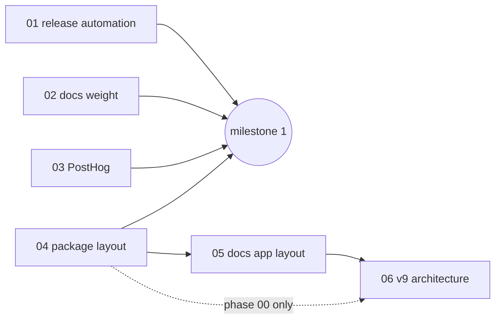

# v0.4.0 plan

Index of a multi-part plan. Decisions: [decisions.md](decisions.md); parts implement them
and never re-decide. Part files follow `docs/code-of-conduct/planning-guidelines.md`.

## Parts

| # | Part | Touches | Size |
| --- | --- | --- | --- |
| 01 | [release automation](01-release-automation.md) | `scripts/`, `.github/workflows/`, `CHANGELOG.md`, one docs route | hours |
| 02 | [docs weight](02-docs-weight.md) | three docs components, one page check | hours |
| 03 | [PostHog](03-posthog.md) | docs provider, rewrites, seven hook points, `CONTRIBUTING.md` | hours |
| 04 | [package layout](04-package-layout.md) | `packages/shadcn-table` tree, configs, registry scripts, CI guard | days |
| 05 | [docs app layout](05-docs-app-layout.md) | `apps/shadcn-table-docs` folder, `ui-radix`, example variants, installer | days |
| 06 | [v9 architecture](06-v9-architecture.md) | library internals on both trees | weeks |
| 07 | [Radix Select loop](07-radix-select-loop.md) | `pnpm-lock.yaml`, two `package.json`, `CHANGELOG.md`, one page check | hours |

## Dependencies

- 01, 02, 03 and 04 run at the same time, one worktree and branch each
  (`shadcn-react-table.worktrees/<part>`, `v0.4/<part>`).
- 05 starts when 04 is merged: the docs installer reads the registry from the new tree.
- 06 starts when 05 is merged, so every rewrite edit lands once on final paths; its phase 00
  (comparison, read-only) may start once 04 is merged.
- 02 and 05 both touch `example-snippet.tsx`, `example-playground.tsx`, `code-explorer.tsx`
  and `lib/example-variants.mjs`: 02 merges first, 05 rebases on it.
- 03 and 05 both touch `components/base-selector.tsx` and `components.json` neighbours: 03
  merges first.

## Integration

- Work branches merge into `claude/review` with a merge commit after the part's gates and
  the repo gates (`docs/code-of-conduct/coding-standards.md`, "Gates") are green in CI.
- `claude/review` merges into `master` at each milestone; Vercel deploys `master`.
- Milestones: after 01 to 04 (docs lighter, analytics live, release workflow proven by its
  dry run), after 05, after 06. One tag for the cycle, `v0.4.0`, at the end.

## Workflow

One Workflow run per part, resumable. Per part: a coder agent in the worktree, a reviewer
agent that walks the part file top to bottom and refutes the coder's report, a gate agent
that runs the part's gates and the repo gates on the merged result; up to 3 bounces between
coder and reviewer. 06 has its own cluster pipeline, see its file. The lead merges and
writes the tracker (`<part>-tracker.md` next to the part file, decisions and deviations
only).

Halt and ask the owner on: a public API or naming choice not covered by the decisions, more
than 3 bounces, an unfixable gate, a finding that contradicts a recorded decision.

## Process rules

- No `git add -A`, no commit trailers or attribution, push right after every commit, no
  comment-only or format-only commits, format once before each commit.
- Ports never to use: 3000, 5173, 5273, 5320, 5404, 5406, 6006, 6007, 6306. Never `pkill`;
  stop only processes you started, by PID.
- Revert `lib:install` side effects (`app/global.css`, `tsconfig.json` `.next-*` entries)
  before committing.
- Browser checks with Playwright from `packages/shadcn-table/node_modules`, never from
  screenshots.
