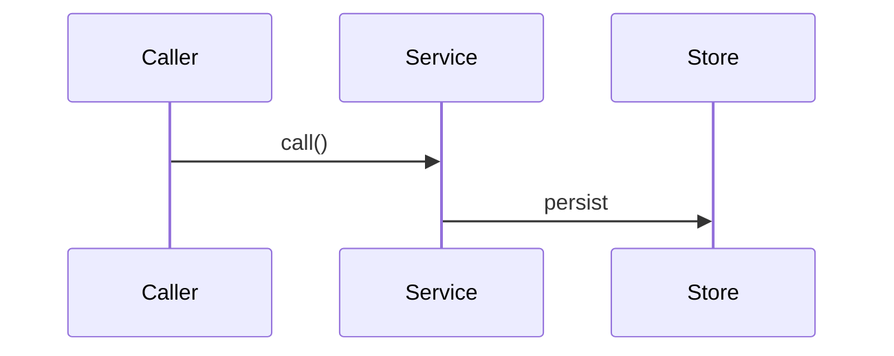

# Planning Guidelines

How to write an implementation plan for this repository. Applies to humans and agents.

## Location

```
.ai/plans/<plan>/<git_username>/
├── <plan>-plan.md       ← the plan (template below); for a multi-part plan the index: goals, parts, dependency graph, integration
├── decisions.md         ← every decision the owner made, grouped, with the why
├── 01-<part>.md         ← optional: one file per part when the plan is too large for one file
├── 02-<part>.md
└── reference/           ← optional supporting material
```

Default is one file, `<plan>-plan.md`. Split into part files only when the plan outgrows it;
the index then holds what is shared. `<git_username>` is the GitHub login.

## Rules

1. **Discuss before writing.** Agree scope in chat first. Record the outcome in
   `decisions.md`; the plan implements it and never re-decides.
2. **Draft during the discussion** for anything non-trivial, so both sides argue against the
   same text.
3. **No questions in plan files.** Open items are asked in chat. Once answered they go to
   `decisions.md`.
4. **Structure over prose.** Tables, trees, bullets. Short prose only for a component intro.
5. **Mermaid for flows, ASCII trees for structure.** No hand-drawn box diagrams. Sketches
   made with Excalidraw go in `reference/` as `.excalidraw`, linked from the section they
   illustrate.
6. **No marketing prose.** Plain section names, direct descriptions, exact technical terms.
7. **Status on every operation**: `new`, `keep` or `refactor`. A stub is `new` with "stub,
   implement in phase N".
8. **Pin what stays unchanged.** Every component lists what it touches but does not modify.
9. **Design in, implementation out.** Include interfaces, types, constants, file shapes,
   usage examples. Never method bodies or algorithm walkthroughs. Test: a decision goes in;
   how to do it stays in the code.
10. **Cleanup phase always last.** Delete old code, update references, run the repo gates.
11. **Gates per phase.** Each phase names the commands that must pass, per base where the
    repository has bases.
12. **No em dashes.** Use a comma, a colon or a new sentence.

## Template

Numbering is strict: every heading under `## 1.` and `## 2.` carries its dotted number.
A skipped optional section keeps its heading with `: none` after the name, so numbers stay
stable and no reader guesses at a gap.

````markdown
# [Part name]

## 1. Architecture

### 1.1 Overview

Two or three sentences: the problem and why this part exists. Link the decision.

### 1.2 Goals

- Measurable outcome
- Measurable outcome

### 1.3 Current structure _(optional, skip for greenfield)_

```
path/today/
├── file-a.ts
└── file-b.ts
```

### 1.4 Target structure

```
path/after/
├── file-a.ts        ← one-line purpose
└── sub/
    └── file-c.ts    ← one-line purpose
```

### 1.5 Flow _(optional, for dispatch, state machines, cross-service flows)_



Sketch: [reference/flow.excalidraw](reference/flow.excalidraw) _(when one exists)_

### 1.6 Components

One block per logical unit the part introduces or modifies. Required: a short description
and a bullet list of what it does and does not do. Optional: operations table, interfaces,
dependencies, stays unchanged, usage examples.

#### 1.6.1 Data artifacts _(optional, always first when present)_

Registry items, config files, generated files, changelog entries: what changes in them.

#### 1.6.2 [Component]

Description and the scope decisions that shaped it.

- Does X
- Does NOT do Y

**Operations:**

| Operation | Status | Notes |
| --------- | ------ | ----- |
| `doX()`   | new    |       |

**Interfaces:**

```typescript
export interface Example {
  readonly id: string;
}
```

**Stays unchanged:** files this component touches without modifying.

**Usage:**

```typescript
example.doX({ id });
```

### 1.7 Dependencies and env _(optional)_

New packages, env vars (name, default, purpose), reused infrastructure.

## 2. Instructions for AI

### 2.1 Phases

#### 2.1.1 Phase 1: [Name]

- Step
- Step

#### 2.1.N Final phase: Cleanup

- Delete old code, update references
- Repo gates

### 2.2 Gates

- `command` per base, what green means
````

## Example

Full example: `.ai/plans/v0.4.0/anindosarker/02-docs-weight.md`. Minimal shape:

````markdown
# 02: docs weight

## 1. Architecture

### 1.1 Overview

Docs pages ship build-time highlighted code for every example file on both bases, 1 to 5 MB
per page. Decision: highlight on the client, on demand.

### 1.2 Goals

- `guides/editing` HTML plus RSC under 400 KB
- Code view behaviour unchanged for the reader

### 1.3 Current structure: none

### 1.4 Target structure

```
apps/shadcn-table-docs/components/
├── code-explorer.tsx            ← renders DynamicCodeBlock for the active file
└── mdx/example-snippet.tsx      ← passes raw source strings only
```

### 1.5 Flow: none

### 1.6 Components

#### 1.6.1 CodeExplorer

Client component; highlights the active file when opened.

- Renders `DynamicCodeBlock` with the file's source and language
- Does NOT receive highlighted nodes from the server

**Operations:**

| Operation       | Status   | Notes                              |
| --------------- | -------- | ---------------------------------- |
| `ExplorerFile`  | refactor | `node` removed, `lang` added       |
| active file pane| refactor | `DynamicCodeBlock`, Suspense fallback |

**Stays unchanged:** file tree, copy button, max height.

### 1.7 Dependencies and env: none

## 2. Instructions for AI

### 2.1 Phases

#### 2.1.1 Phase 1: Explorer

- Change `ExplorerFile`, render `DynamicCodeBlock`

#### 2.1.2 Final phase: Cleanup

- Remove `highlight` and `CodeBlock` imports from `example-snippet.tsx`
- `pnpm format`, docs `types:check`, `lint`, `build`

### 2.2 Gates

- Docs `build`; `du` on `.next/server/app/docs` under 15 MB
- `check-pages.mjs a` and `e` against `next start`
````
